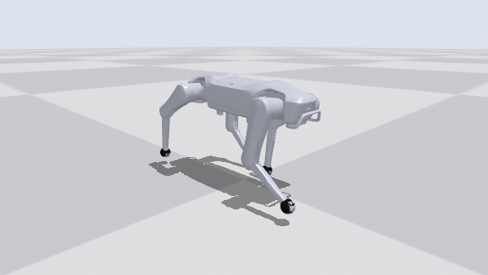
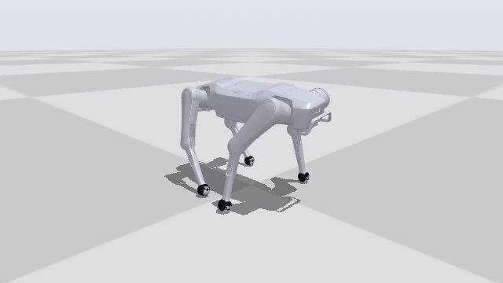
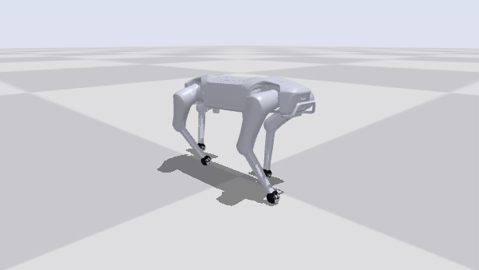
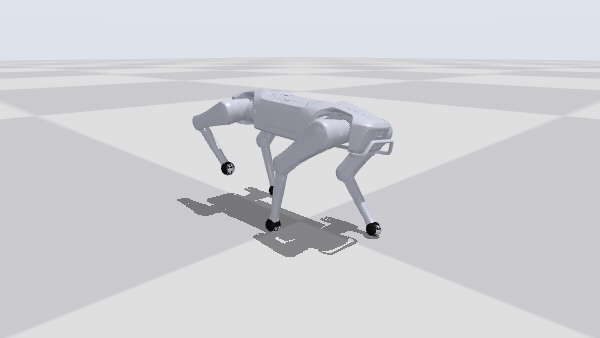
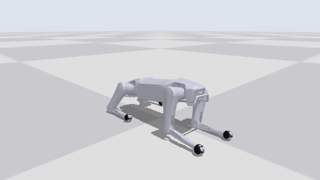
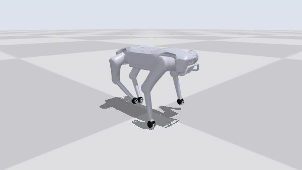

# SuperMimic-Quadruped

**English** · [简体中文](README.zh-CN.md)

Motion tracking for quadruped robots with [SuperMimic](https://arxiv.org/abs/2610.28480) (one learned
differentiable world model + short-horizon backpropagation through imagined rollouts). Public dog motion
capture is retargeted to a 12-DoF quadruped, and one policy learns to track all of it. The reference robot is
the **Dobot Rover X1**; the retargeting tools take other 12-DoF dogs from a small config file
(Unitree Go1 included as an example).

## Showcase

Silver: the policy, simulated in MuJoCo Warp. Blue: the reference motion it tracks (retargeted dog motion
capture), drawn at the same place and visible only where it differs from the robot. Benchmark protocol: deterministic policy, no noise or randomisation. "Return" is
the paper's normalised tracking return (1.0 = perfect tracking at every step).

| | | |
|:---:|:---:|:---:|
|  |  |  |
| **Run**, up to 2.9 m/s<br><sub>Tencent Labrador · return 0.67</sub> | **Zig-zag**, yaw rate up to 4 rad/s<br><sub>Tencent Labrador · return 0.90</sub> | **Turn with 35° body tilt**<br><sub>AI4Animation · return 0.95</sub> |
|  |  |  |
| **Turn in place**, 140° in 2.4 s<br><sub>AI4Animation · return 0.86</sub> | **Rise from a low crouch**, 20 cm<br><sub>AI4Animation · return 0.97</sub> | **Trot and turn, held-out take** (never trained on)<br><sub>AI4Animation · return 0.91</sub> |

## Results

One run (50k iterations, 4.6 h on one H200, 20,480 parallel environments), evaluated on every clip of the
library (counts include left-right mirrors):

| group | clips | failed | mean return | what it is |
|---|---|---|---|---|
| train | 251 | 0 | 0.937 | clips the open-loop screen finds easy |
| hard | 237 | 0 | 0.838 | clips whose open-loop replay falls (mostly trots and runs); trained at half weight |
| holdout | 78 | 0 | 0.876 | whole recordings left out of training |

A clip *fails* when a training termination fires (root height off by 0.15 m or tilt off by 60° from the
reference). The weakest clips (return 0.45-0.5) are Tencent high jumps, walk-run transitions and one fast
held-out trot; none of them falls.

## Roadmap

- **Coming soon:** a SONIC-style controller on top of this tracker: a kinematic motion planner turns joystick
  velocity commands into reference motion in real time, and the tracking policy follows it.

## What's inside

```
public mocap ──► retarget (quadmotion) ──► check ──► screen ──► groups ──► train (SuperMimic) ──► eval / render
3 sources        IK, foot locking,          FK,       open-loop   train /     world model +          benchmark,
~470 MB          Froude time, cuts,         feet,     PD replay   hard /      BPTT through           rollouts,
                 mirrors                    limits    windows     holdout     imagined rollouts      GIFs
```

- **Data** (`scripts/data/`, `src/quadmotion/`): three public sources, downloaded at pinned revisions with
  SHA-256 checks (`configs/sources.yaml`):

  | source | raw | kept on the Rover X1 |
  |---|---|---|
  | AI4Animation dog mocap (SIGGRAPH 2018) | 51 takes | 191 clips, 23.1 min |
  | Tencent Labrador mocap (NMI 2024) | 33 takes | 82 clips, 8.5 min |
  | Xiaomi CyberDog2 motion lists | 37 lists | 10 clips, 1.0 min |
  | **total** | | **283 clips, 32.5 min (566 / 65 min with mirrors)** |

  Dog clips: shoulder / hip and paw keypoints → trunk frame → scale to the robot's standing height → time
  stretched by √scale so that flight phases stay ballistic → planted paws detected and locked → analytic IK
  (knees backwards) → per-frame checks (reach, joint limits and speed, trunk and knees above the floor, tilt,
  crossed feet, flight, speed) → clips cut at failing frames → left-right mirrors. CyberDog2 motion lists are
  interpreted step by step and their amplitude lowered until every frame passes.
- **Screen** (`scripts/data/screen_clips.py`): 2 s windows of open-loop PD replay; a clip whose windows fall
  more than 20 % of the time is `hard`. Whole recordings (~10 % of each source) are held out.
- **Training** (`src/supermimic/`): SuperMimic on [mjlab](https://github.com/mujocolab/mjlab) / MuJoCo Warp.
  A world model learns the simulator's dynamics from 8-step windows of collected transitions; the policy is
  improved by backpropagating the analytic tracking reward through 32-step rollouts imagined in that model;
  a critic bootstraps the return. The policy sees only what the robot measures (joint angles and velocities,
  angular velocity, gravity direction, last action; 10 frames of history) plus 10 future reference frames.
- **Robot** (`src/supermimic/robots/rover.py`): the Rover X1 model (meshes and licence from Dobot's official
  [dobot_rover_simulation](https://github.com/Dobot-Team/dobot_rover_simulation)), PD gains kp 25 / kd 1.3 (from a
  locally trained RL walking policy), torque limits 23 / 23 / 55 N·m, randomised foot friction, encoder bias and trunk COM. Every number
  in the spec says where it comes from.

## Quick start

Needs Linux, an NVIDIA GPU, Python 3.12 and [uv](https://docs.astral.sh/uv/).

```bash
uv sync

# Data: download (~470 MB), retarget, check, screen (GPU), assign groups
uv run python scripts/data/fetch_sources.py
uv run python scripts/data/build_dataset.py --robot rover
uv run python scripts/data/check_library.py --robot rover
uv run python scripts/data/screen_clips.py --robot rover
uv run python scripts/data/assign_groups.py --robot rover

# Train (the configuration of the run above; ~72 GiB of GPU memory)
uv run sm-train --run-name rover --robot rover \
  --data.npz-dir data/npz/rover --data.manifest data/npz/rover/manifest.csv --data.group train,hard \
  --env.clip-weight-alpha 0.5 --env.static-bin-factor 0.25 \
  --env.num-envs 20480 --wm-trainer.batch-size 10240 --policy-trainer.batch-size 20480 \
  --schedule.total-iterations 50000 --schedule.lr-decay-fraction 1.0

# Evaluate, record and render
uv run python scripts/eval_benchmark.py --ckpt logs/rover/ckpt_latest.pt \
  --npz-dir data/npz/rover --manifest data/npz/rover/manifest.csv --group holdout
uv run python scripts/record_rollouts.py --ckpt logs/rover/ckpt_latest.pt \
  --npz-dir data/npz/rover --manifest data/npz/rover/manifest.csv --exclude '_mirror$'
MUJOCO_GL=egl uv run python scripts/render_rollouts.py --rollouts logs/rover/rollouts_ckpt_latest.npz \
  tencent_dog_zig_walk_002_s16
```

On a smaller GPU, scale the three sizes down together: `--env.num-envs 1024 --wm-trainer.batch-size 1024
--policy-trainer.batch-size 1024` runs in about 5.5 GiB at ~6 it/s on a 12 GB RTX 5070 (a short smoke run; only
the full configuration above has been trained to the end). `uv run pytest` runs the tests (those that need the library or a GPU skip without them).

## Other robots

[docs/PORTING.md](docs/PORTING.md): a YAML file per robot for the retargeting (`configs/robots/`), a Python
spec per robot for training (`src/supermimic/robots/`). The retargeting supports 12-DoF quadrupeds whose legs
are an abduction hinge about x and two pitch hinges about y (Rover X1, Go1, Go2, A1, ...). As a check,
`configs/robots/go1.yaml` turns the same sources into 520 clips (57.6 min) for mjlab's Unitree Go1, all passing
`check_library.py`; there is no Go1 training spec yet.

## Repository layout

```
configs/robots/        retargeting description per robot (rover.yaml, go1.yaml)
configs/sources.yaml   pinned sources: URL, licence, SHA-256 of every file
scripts/data/          fetch_sources, build_dataset, check_library, screen_clips, assign_groups, render_preview
scripts/               eval_benchmark, record_rollouts, render_rollouts, calibrate_scales, play
src/quadmotion/        retargeting: robot model and IK, BVH reader, dog mocap, CyberDog2 interpreter, clip I/O
src/supermimic/        SuperMimic: env, world model, imagination, training loop, robot specs (rover, g1)
docs/                  PORTING.md
assets/showcase/       the GIFs above
```

## Acknowledgements and licence

- SuperMimic: Q. Liao, Y. Shao, J. Long, K. Zakka, R. Horowitz, P. Abbeel, K. Sreenath, *SuperMimic: Scaling
  Humanoid Whole-Body Control with One Differentiable World Model*, [arXiv:2610.28480](https://arxiv.org/abs/2610.28480).
- The training code is built on [CuboiLeo/SuperMimic-Reproduced](https://github.com/CuboiLeo/SuperMimic-Reproduced)
  (MIT, © Yuxi Liu), the G1 reproduction, including the get-up extension from
  [Mr-Zqr/SuperMimic-Reproduced](https://github.com/Mr-Zqr/SuperMimic-Reproduced). The world model, imagination
  and training loop are theirs; this repository adds the robot abstraction for the quadruped, the Rover X1 spec,
  the retargeting and data pipeline, and the rendering. `src/supermimic/robots/g1.py` is kept as the upstream
  humanoid reference; its tests need the upstream LAFAN1 data and skip without it.
- Simulation: [mjlab](https://github.com/mujocolab/mjlab) and MuJoCo Warp. Robot model: meshes and licence from Dobot's [dobot_rover_simulation](https://github.com/Dobot-Team/dobot_rover_simulation) (BSD-3-Clause, © Dobot Robotics).
- Code: MIT (`LICENSE`). Motion data is **not** included; the sources' licences apply to anything built from
  them, and AI4Animation's (CC BY-NC 4.0) rules out commercial use. See `THIRD_PARTY_NOTICES.md`.
