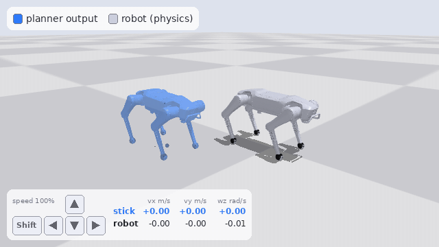
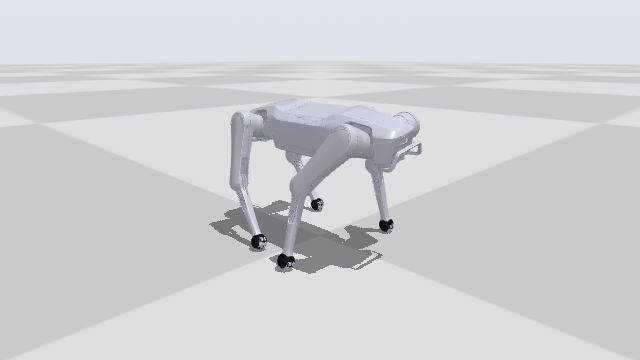
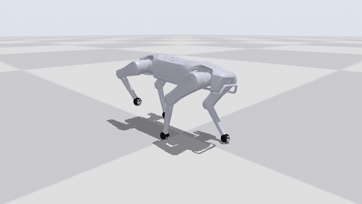
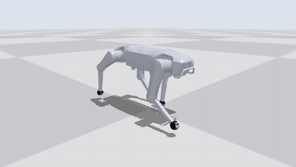
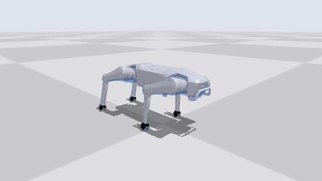
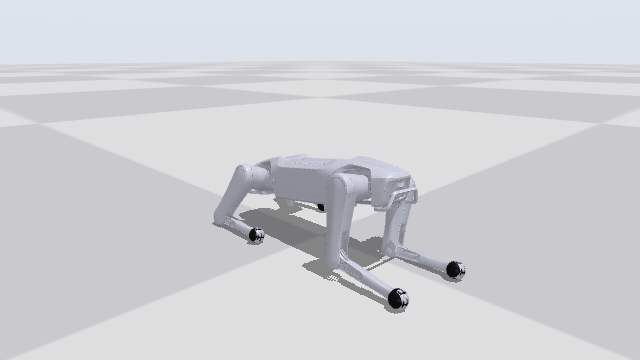
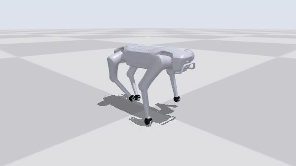

# SuperMimic-Quadruped

[English](README.md) · **简体中文**

用 [SuperMimic](https://arxiv.org/abs/2610.28480)（一个学出来的可微世界模型 + 在想象轨迹上做短视野反传）给四足机器人做动作跟踪和摇杆行走。
把公开的狗动作捕捉数据重定向到 12 自由度的四足机器人上，用**一个**策略跟踪全部动作；再用一个 SONIC 风格的运动学规划器把摇杆输入实时生成参考动作，
由同一个跟踪策略执行。参考机器人是**越疆 Rover X1**；重定向工具只需一个配置文件就能换成其他 12 自由度机器狗（附 Unitree Go1 示例）。

**更新（2026-10-31）：** 新增摇杆行走规划器；跟踪器 `rover_r2` 在 665 段的动作库上训练；两者都提供[预训练模型](#运行发布的模型)。

## 摇杆控制



左下角是按键（按住时高亮），按键决定摇杆值；规划器根据摇杆生成接下来 1 秒的参考动作，每 0.1 秒重新规划一次；跟踪策略在物理仿真里执行。
**蓝色：** 规划器的输出，画在机器狗旁边，前面的圆点是它当前的规划路径。**银色：** MuJoCo Warp 里的跟踪策略。
方向键前进、后退、转向，Shift + 左右方向键横移；摇杆值就是机器人的速度，最高前进 1.5 m/s、后退 0.8 m/s、横移 0.5 m/s、转向 0.9 rad/s。
画面为实时速度，由 `scripts/planner/render_teleop.py` 生成。

另有五个按键播放动作库里的技能（坐下、握手、击掌、伸懒腰、姿态串烧的跳舞）：机器狗先停稳，过渡到这段动作，播放完再过渡回站立，然后继续行走。

## 动作跟踪

银色：策略在 MuJoCo Warp 物理仿真中的动作；蓝色：它要跟踪的参考动作，与机器狗画在同一位置，只在和机器狗不重合的地方露出来。评测口径：确定性策略，
无噪声、无随机化。"return" 是论文中的归一化跟踪回报（1.0 表示每一步都完美跟踪）。

| | | |
|:---:|:---:|:---:|
|  |  |  |
| **之字形急转**，偏航角速度最高 4 rad/s<br><sub>腾讯拉布拉多 · return 0.89</sub> | **原地转身**，2.4 秒转 140°<br><sub>AI4Animation · return 0.84</sub> | **奔跑**，最高 2.9 m/s<br><sub>腾讯拉布拉多 · return 0.67</sub> |
|  |  |  |
| **趴下再起身**，机身降到离地 10 cm<br><sub>全身 IK 生成 · return 0.99</sub> | **从趴姿站起（留出集，训练时从未见过）**<br><sub>AI4Animation · return 0.98</sub> | **小跑转身（留出集）**<br><sub>AI4Animation · return 0.91</sub> |

## 结果

**跟踪器** `rover_r2`（5 万次迭代，单张 H200 上 4.6 小时，20,480 个并行环境），在动作库的每一段上评测（片段数含左右镜像）：

| 分组 | 片段 | 失败 | 平均 return | 含义 |
|---|---|---|---|---|
| train | 307 | 0 | 0.937 | 开环筛选认为容易的片段 |
| hard | 270 | 0 | 0.854 | 开环回放会摔倒的片段（多为小跑和奔跑），以一半权重参与训练 |
| holdout | 88 | 0 | 0.891 | 整条录制留出，不参与训练 |

"失败"指触发了训练时的终止条件（机身高度偏离参考 0.15 m，或倾角偏离 60°）。最弱的片段（return 0.5–0.6）是腾讯数据里的快速奔跑，
机器狗会落后参考 10–20 cm，但都没有摔倒。

**摇杆行走**（`rover_v2_l1` 规划器 + `rover_r2`，`scripts/planner/closed_loop.py`）：125 台机器狗各跑 60 秒，随机摇杆在整个摇杆范围内保持、渐变：

| | 无随机化 | 域随机化 |
|---|---|---|
| 摔倒 | 0 | 0 |
| 机器人速度 / 摇杆，vx / vy / 偏航角速度 | 0.97 / 0.99 / 0.98 | 0.97 / 1.00 / 0.98 |
| 稳态误差，vx / vy（m/s）/ 偏航角速度（rad/s） | 0.018 / 0.010 / 0.015 | 0.020 / 0.014 / 0.022 |
| 有关节达到扭矩上限的步数 | 0 % | 0 % |

## 项目内容

```
公开动捕 ──► 重定向 (quadmotion) ──► 检查 ──► 筛选 ──► 分组 ──► 训练 (SuperMimic) ──► 评测 / 渲染
3 个来源      IK、脚步锁定、           FK、     开环 PD   train /   世界模型 +             benchmark、
约 470 MB     Froude 时间缩放、        脚、     分窗回放  hard /    在想象轨迹上反传        录像、GIF
              切段、镜像               限位               holdout

按键 ──► 摇杆 ──► 行走规划器 ──► 接下来 10 帧参考 ──► 跟踪策略 ──► 机器人
         渐变     MLP，0.5 秒上下文 ──► 1 秒规划，每 0.1 秒在自己的输出上重新规划
```

- **数据**（`scripts/data/`、`src/quadmotion/`）：三个公开来源，按固定版本下载并校验 SHA-256（`configs/sources.yaml`）：

  | 来源 | 原始数据 | 在 Rover X1 上保留 |
  |---|---|---|
  | AI4Animation 狗动捕（SIGGRAPH 2018） | 51 条 | 191 段，23.1 分钟 |
  | 腾讯拉布拉多动捕（NMI 2024） | 33 条 | 82 段，8.5 分钟 |
  | 小米 CyberDog2 动作表 | 37 个 | 10 段，1.0 分钟 |
  | **合计** | | **283 段，32.5 分钟（含镜像 566 段，65 分钟）** |

  狗动捕的处理流程：取肩、髋和四个爪子的关键点 → 建立机身坐标系 → 按站立高度缩放到机器人尺寸 → 时间按 √缩放比 拉伸，
  让腾空阶段仍符合重力 → 检测着地的爪子并锁定 → 解析 IK（膝盖朝后）→ 逐帧检查（可达性、关节限位和速度、机身和膝盖不触地、
  倾角、脚交叉、腾空、速度、原始数据开头的停滞帧）→ 在不合格的帧处切段 → 左右镜像。CyberDog2 动作表逐步解释执行，并降低幅度直到每一帧都通过检查。

  `rover_r2` 还用了 99 段这里的管线不生成的片段，作为 [`rover_r2_extra_clips.tar.gz`](#构建数据并训练) 发布：78 段本地训练的 RL 行走策略的行走片段
  （起步、停步、横移、后退、转弯），16 段为 Rover 生成的动作（带质心支撑约束的全身 IK 生成的抬腿、挥腿、太空步、趴下；Crocoddyl 最优控制生成的跳跃、原地小跑），
  3 段关键帧生成的下蹲和小跳，以及 1 段 motion_imitation 参考动作（含镜像）。共 665 段，含镜像 87 分钟。
- **筛选**（`scripts/data/screen_clips.py`）：每 2 秒一个窗口做开环 PD 回放，超过 20% 的窗口摔倒的片段记为 `hard`。
  每个来源约 10% 的整条录制留作 holdout。
- **训练**（`src/supermimic/`）：基于 [mjlab](https://github.com/mujocolab/mjlab) / MuJoCo Warp 的 SuperMimic。
  世界模型用采集到的 8 步窗口学习仿真器的动力学；策略通过在世界模型里想象 32 步、把解析的跟踪奖励反传回来更新；
  critic 负责估计后续回报。策略只看机器人自己能测到的量（关节角和角速度、机身角速度、重力方向、上一步动作，10 帧历史）
  加上 10 帧未来参考动作。
- **行走规划器**（`src/supermimic/planner/`、`scripts/planner/`、[docs/PLANNER.zh-CN.md](docs/PLANNER.zh-CN.md)）：一个残差 MLP（1000 万参数），
  输入最近 0.5 秒的参考（关节角、高度、倾角、朝向坐标系下的速度、偏航角速度）和摇杆值，输出接下来 1 秒。它在自己的输出上自回归运行，
  从不读取机器人状态，所以跟踪器拿到的参考始终和训练数据同一个样子。训练数据是本地训练的 RL 行走策略在随机摇杆下的 12.5 小时录制（不公开）；
  摇杆值是机器人的实际速度（拟合了行走策略"指令 → 实际速度"的映射），行走策略 0.6 秒的步态时钟也作为输入，所以从站立起步不会打滑。
  松开摇杆后，站立保持会让参考停在一帧站姿上。
- **机器人**（`src/supermimic/robots/rover.py`）：Rover X1 模型（网格和许可证来自越疆官方的
  [dobot_rover_simulation](https://github.com/Dobot-Team/dobot_rover_simulation)），PD 增益 kp 25 / kd 1.3（来自本地训练的 RL 行走策略），
  扭矩上限 23 / 23 / 55 N·m，随机化足端摩擦、编码器偏置和机身质心。spec 里每个数字都注明了出处。

## 快速开始

需要 Linux、NVIDIA GPU、Python 3.12 和 [uv](https://docs.astral.sh/uv/)。

### 运行发布的模型

```bash
uv sync
# rover_r2 跟踪器（仅策略）、rover_v2_l1 规划器和一个站立起始状态，解压到 logs/（64 MB）
curl -L https://github.com/Houserz/supermimic-quadruped/releases/download/v0.2.0/rover_models.tar.gz | tar xz

MUJOCO_GL=glfw uv run python scripts/planner/teleop.py                       # 键盘操控
MUJOCO_GL=egl uv run python scripts/planner/render_teleop.py --out out/joystick.gif
uv run python scripts/planner/closed_loop.py --clips 25                      # 随机摇杆，输出指标
```

技能按键需要动作库里的 CyberDog2 片段（按下面的步骤构建）；只行走不需要。

### 构建数据并训练

```bash
# 数据：下载（约 470 MB）、重定向、检查、筛选（需 GPU）、分组
uv run python scripts/data/fetch_sources.py
uv run python scripts/data/build_dataset.py --robot rover
uv run python scripts/data/check_library.py --robot rover
uv run python scripts/data/screen_clips.py --robot rover
uv run python scripts/data/assign_groups.py --robot rover

# 可选：rover_r2 的动作库 = 上面的 566 段 + 99 段额外片段，附 rover_r2 的 manifest（45 MB）
curl -L https://github.com/Houserz/supermimic-quadruped/releases/download/v0.2.0/rover_r2_extra_clips.tar.gz | tar xz
# ……然后训练时用 --data.manifest data/npz/rover/manifest_r2.csv

# 训练（即上面结果的配置，约需 72 GiB 显存）
uv run sm-train --run-name rover --robot rover \
  --data.npz-dir data/npz/rover --data.manifest data/npz/rover/manifest.csv --data.group train,hard \
  --env.clip-weight-alpha 0.5 --env.static-bin-factor 0.25 \
  --env.num-envs 20480 --wm-trainer.batch-size 10240 --policy-trainer.batch-size 20480 \
  --schedule.total-iterations 50000 --schedule.lr-decay-fraction 1.0

# 评测、录制、渲染
uv run python scripts/eval_benchmark.py --ckpt logs/rover/ckpt_latest.pt \
  --npz-dir data/npz/rover --manifest data/npz/rover/manifest.csv --group holdout
uv run python scripts/record_rollouts.py --ckpt logs/rover/ckpt_latest.pt \
  --npz-dir data/npz/rover --manifest data/npz/rover/manifest.csv --exclude '_mirror$'
MUJOCO_GL=egl uv run python scripts/render_rollouts.py --rollouts logs/rover/rollouts_ckpt_latest.npz \
  tencent_dog_zig_walk_002_s16
```

发布的跟踪器只含策略（没有世界模型、critic 和优化器状态），这里的所有脚本都能用，但不能接着训练。显存较小时，把三个规模参数一起调小：
`--env.num-envs 1024 --wm-trainer.batch-size 1024 --policy-trainer.batch-size 1024` 在 12 GB 的 RTX 5070 上约占 5.5 GiB、约 6 it/s
（只做过短时间的冒烟测试；完整训练到最后的只有上面的完整配置）。`uv run pytest` 运行测试（需要动作库、发布的模型或 GPU 的测试在缺少时会跳过）。
用自己的行走数据训练规划器：见 [docs/PLANNER.zh-CN.md](docs/PLANNER.zh-CN.md)。

## 换成其他机器人

见 [docs/PORTING.zh-CN.md](docs/PORTING.zh-CN.md)：每个机器人一个 YAML 文件用于重定向（`configs/robots/`），一个 Python spec
用于训练（`src/supermimic/robots/`）。重定向支持腿部结构为"绕 x 轴的外展关节 + 两个绕 y 轴的俯仰关节"的 12 自由度四足
（Rover X1、Go1、Go2、A1 等）。作为验证，`configs/robots/go1.yaml` 把同样的数据转换成了 mjlab 自带 Unitree Go1 的 520 段
（57.6 分钟），全部通过 `check_library.py`；Go1 暂时还没有训练 spec。

## 目录结构

```
configs/robots/          每个机器人的重定向描述（rover.yaml、go1.yaml）
configs/sources.yaml     固定版本的数据来源：每个文件的 URL、许可证、SHA-256
scripts/data/            fetch_sources、build_dataset、check_library、screen_clips、assign_groups、render_preview
scripts/planner/         teleop、render_teleop、closed_loop、train_planner、fit_velocity_map
scripts/                 eval_benchmark、record_rollouts、render_rollouts、calibrate_scales、play
src/quadmotion/          重定向：机器人模型与 IK、BVH 读取、狗动捕、CyberDog2 解释器、片段读写
src/supermimic/          SuperMimic：环境、世界模型、想象 rollout、训练循环、机器人 spec（rover、g1）
src/supermimic/planner/  行走规划器、技能、键盘和屏幕按键显示
docs/                    PORTING.md、PLANNER.md
assets/showcase/         上面的 GIF
```

## 致谢与许可

- SuperMimic：Q. Liao, Y. Shao, J. Long, K. Zakka, R. Horowitz, P. Abbeel, K. Sreenath, *SuperMimic: Scaling Humanoid Whole-Body
  Control with One Differentiable World Model*，[arXiv:2610.28480](https://arxiv.org/abs/2610.28480)。
- 训练代码基于 [CuboiLeo/SuperMimic-Reproduced](https://github.com/CuboiLeo/SuperMimic-Reproduced)（MIT，© Yuxi Liu）的 G1 复现，
  包括 [Mr-Zqr/SuperMimic-Reproduced](https://github.com/Mr-Zqr/SuperMimic-Reproduced) 的倒地起身扩展。世界模型、想象 rollout
  和训练循环沿用上游实现；本仓库新增了面向四足的机器人抽象、Rover X1 spec、重定向与数据管线、行走规划器和技能，以及渲染工具。
  `src/supermimic/robots/g1.py` 保留为上游人形机器人的参考实现，它的测试需要上游的 LAFAN1 数据，缺少时自动跳过。
- 仿真：[mjlab](https://github.com/mujocolab/mjlab) 和 MuJoCo Warp。机器人模型：网格和许可证来自越疆官方的 [dobot_rover_simulation](https://github.com/Dobot-Team/dobot_rover_simulation)（BSD-3-Clause，© Dobot Robotics）。
  额外片段中生成的动作用了 [Pinocchio](https://github.com/stack-of-tasks/pinocchio) 和 [Crocoddyl](https://github.com/loco-3d/crocoddyl)。
- 代码采用 MIT 许可（`LICENSE`）。仓库里**不包含**动作数据；用这些数据生成的任何东西都受原始来源许可约束，
  其中 AI4Animation 为 CC BY-NC 4.0，不可商用。发布的跟踪器用这些数据训练，所以发布的模型仅供非商业研究使用。详见 `THIRD_PARTY_NOTICES.md`。
